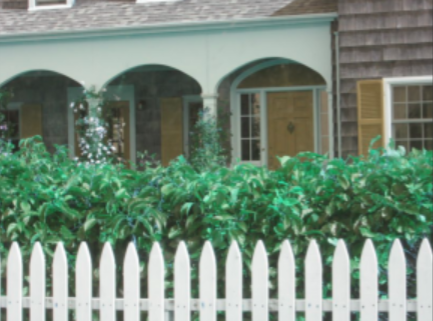
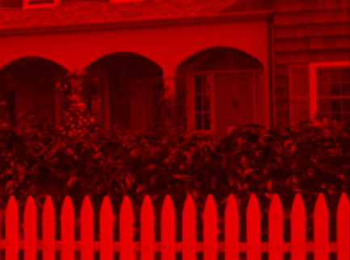
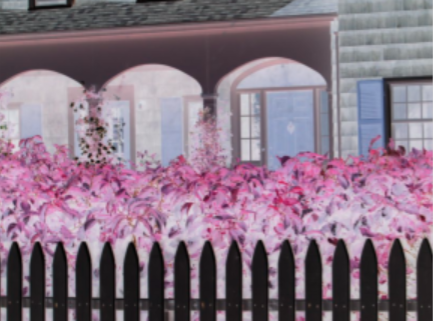
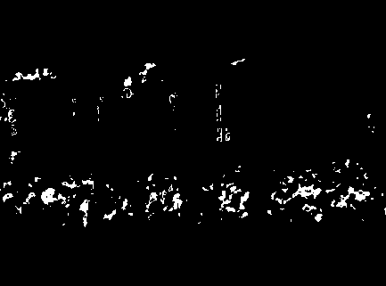
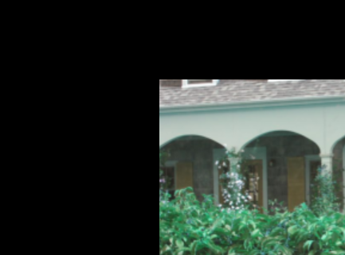
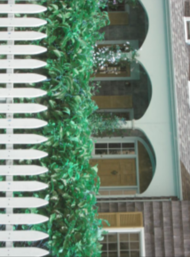
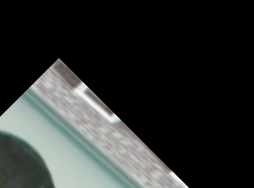
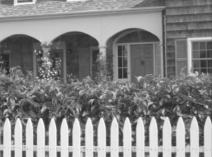
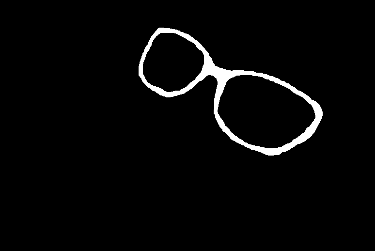
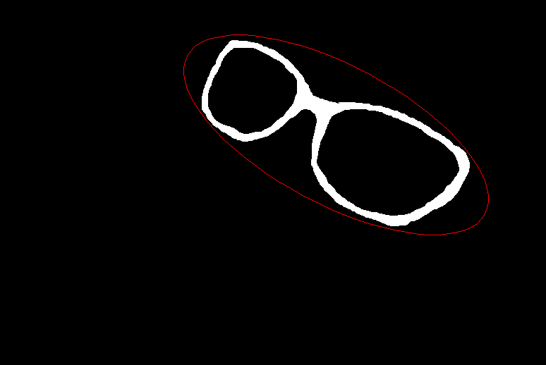

# Homework 1

**Name:** Yuyang Lu  

## 0. Environment

```text
Python: 3.11.17
NumPy: 2.4.6
Matplotlib: 3.11.2
OpenCV: 5.0.0
PyTorch: 2.11.0
```

Package versions were collected separately; `check_package_versions()` currently has its print calls commented out.

## 1. Image loading and analysis

```text
Image object type: <class 'numpy.ndarray'>
Pixel dtype: uint8
Image dimensions (height, width, channels): (321, 433, 3)
Image dtype is uint8: True
Pixel channel is uint8: True
```



## 2. Red channel

Output shape: `(321, 433, 3)`; dtype: `uint8`.



## 3. Photographic negative

Output shape: `(321, 433, 3)`; dtype: `uint8`.



## 4. Swapped red and blue channels

Output shape: `(321, 433, 3)`; dtype: `uint8`.


## 5. Foliage detection

Output shape: `(321, 433)`; dtype: `uint8`.



## 6. Translation

Shift: 200 pixels right, 100 pixels down.

Output shape: `(321, 433, 3)`; dtype: `uint8`.



## 7. Clockwise 90-degree rotation

Output shape: `(433, 321, 3)`; dtype: `uint8`.



## 8. Similarity transform

Parameters: scale = 2.0; theta = 45.0 degrees clockwise; shift = [100.0, 100.0].

Output shape: `(321, 433, 3)`; dtype: `uint8`.



## 9. Grayscale conversion

Output shape: `(321, 433)`; dtype: `uint8`.



## 10. Binary image moments



Foreground pixels are treated as 1 and background pixels as 0.

Returned values:

```text
m00 = 11792
m10 = 5617082
m01 = 2254903
x_bar = 476.346845319
y_bar = 191.223117368
mu20 = 137886399.403
mu02 = 59351807.9782
mu11 = 57699869.45
```

Additional moments requested by the handout (computed separately for this report; not returned by the current function):

```text
m20 = 2813565690
m02 = 490541389
m11 = 1131815800
mu10 = 1.16415321827e-10
mu01 = 1.16415321827e-10
```

## 11. Orientation, eccentricity, and fitted ellipse

```text
Orientation (degrees, clockwise from positive horizontal): 27.8814963047
Eccentricity: 0.91040788693
Ellipse image shape: (518, 774, 3)
Ellipse image dtype: uint8
```


