# Homework 2

**Name:** Yuyang Lu

## 0. Environment

Versions collected from the cv Python environment used to execute Assignment2.py.

```text
Python: 3.11.17
NumPy: 2.4.6
SciPy: 1.17.1
OpenCV: 5.0.0
Matplotlib: 3.11.2
```

## 1. Floodfill

A stack-based 8-connected fill starts at seed (x, y) = (150, 160) and replaces its connected region with BGR (0, 0, 255). The original image is preserved. Output: (292, 639, 3), uint8.

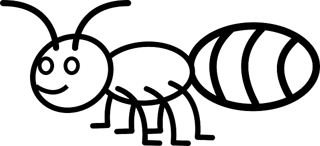

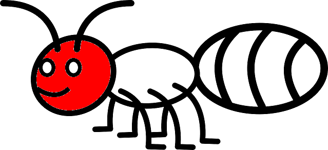

**Why avoid JPEG?** Lossy compression changes pixel colors and introduces boundary artifacts, potentially fragmenting or leaking an exact-color fill. PNG preserves pixel values.

File index 0 means smoothing iteration 1. Floating-point arrays are preserved in `report_outputs/output_arrays.npz`; displayed smoothing images are rounded to uint8 only for presentation.

## 2. Convolution for Gaussian smoothing

Apply 0.25 * [1, 2, 1] vertically, then horizontally, using zero padding and explicit pixel loops. Repeat on the previous result five times. Input: (610, 914), uint8; each returned result: (610, 914), float64. Fine fur texture and edges become progressively smoother.


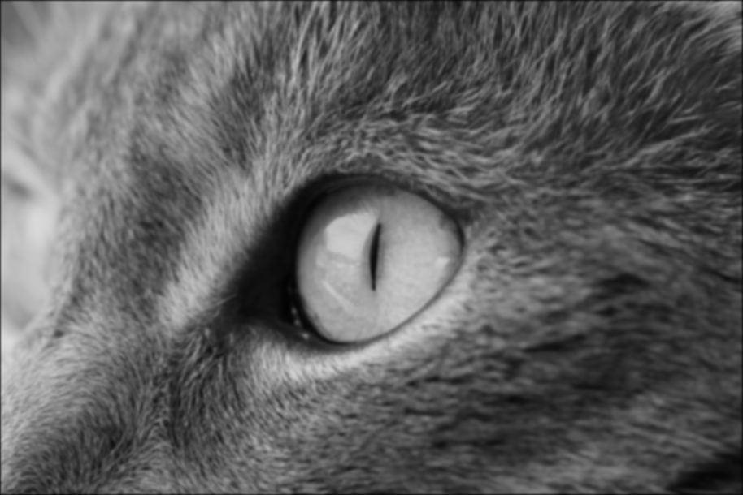

## 3. Vertical Gaussian derivative

For each smoothed image independently, smooth horizontally with 0.25 * [1, 2, 1] and differentiate vertically with 0.5 * [1, 0, -1], without flipping. The 2D kernel is (1/8) * [[1,2,1], [0,0,0], [-1,-2,-1]]. This measures vertical intensity changes and highlights horizontal edges.

Mapping: `clip(2 * derivative + 127, 0, 255).astype(uint8)`. Outputs are single-channel `(610, 914)`; zero padding.


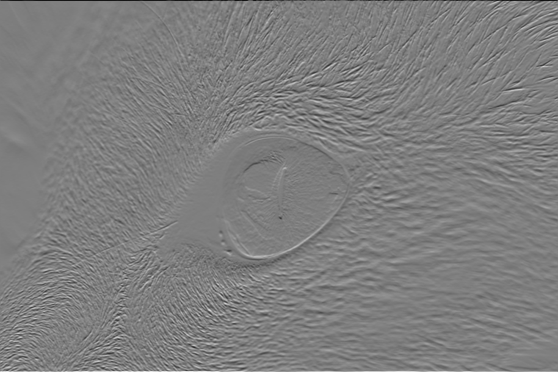

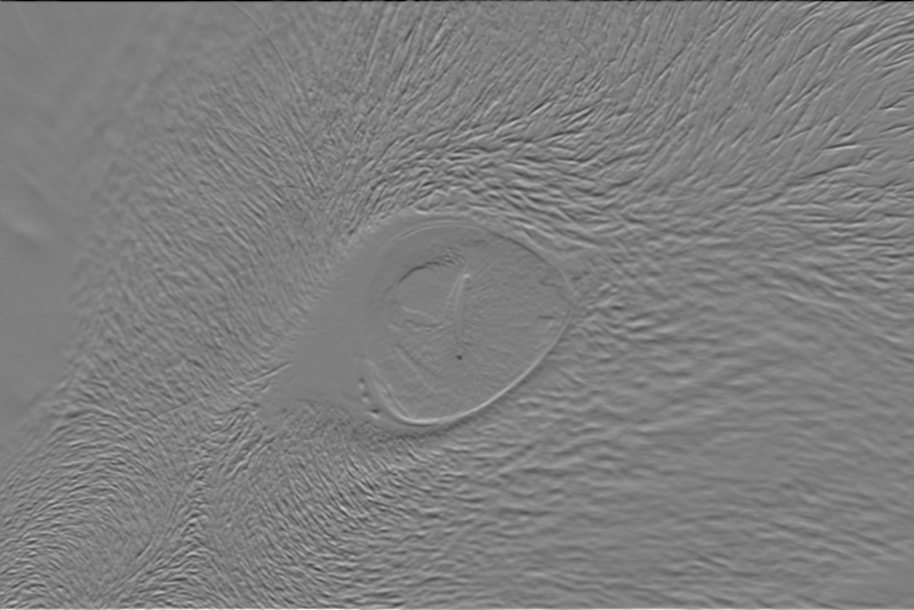


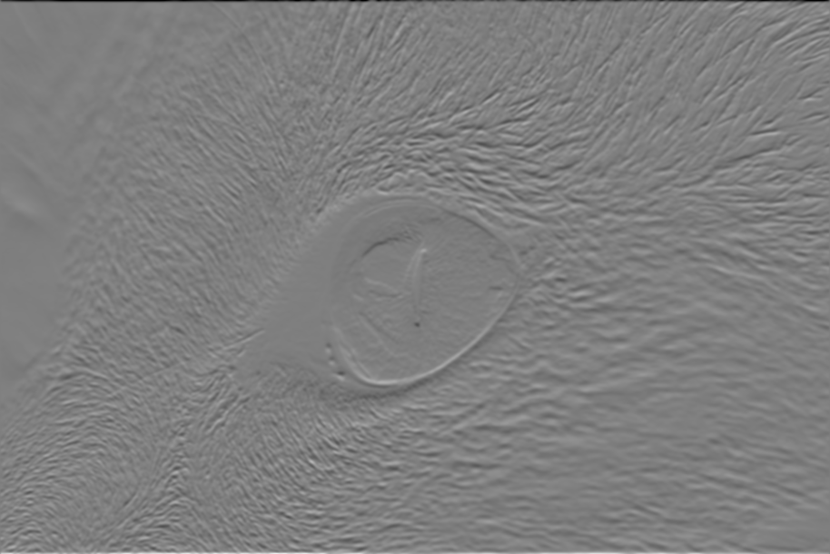

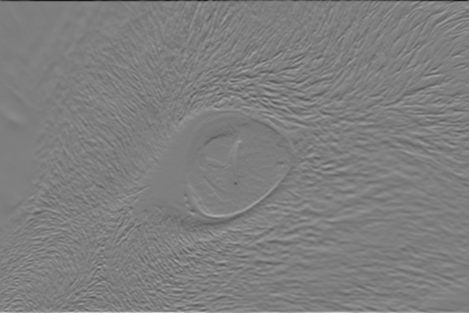

## 4. Horizontal Gaussian derivative

For each smoothed image independently, smooth vertically and differentiate horizontally without flipping. The 2D kernel is (1/8) * [[1,0,-1], [2,0,-2], [1,0,-1]], the transpose of Task 3. This highlights vertical edges.

Mapping: `clip(2 * derivative + 127, 0, 255).astype(uint8)`. Outputs are single-channel `(610, 914)`; zero padding.


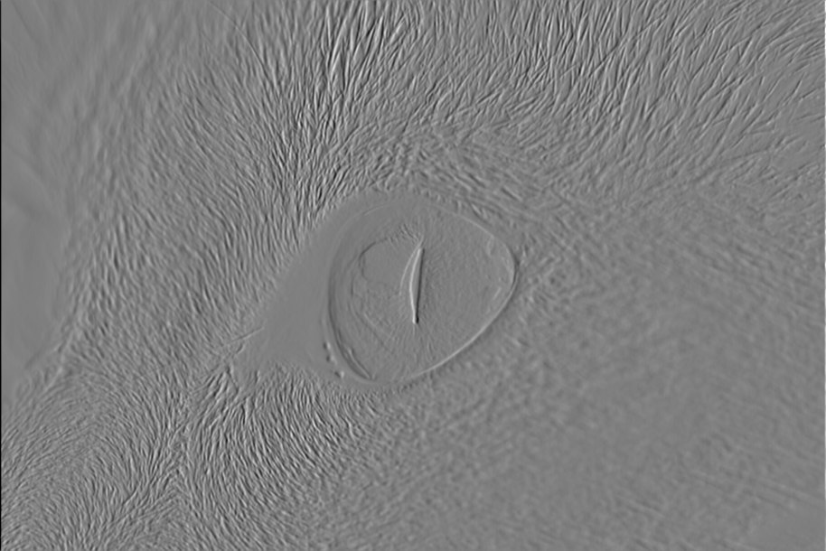

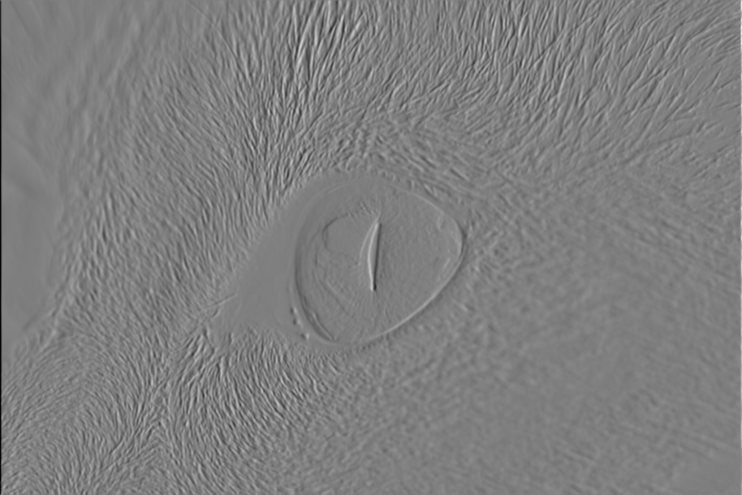

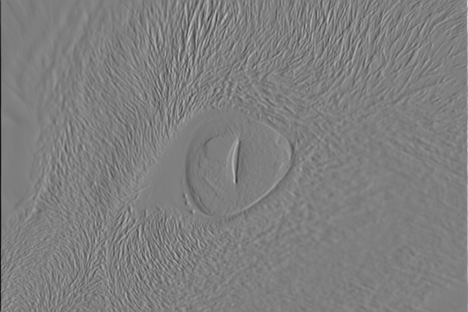

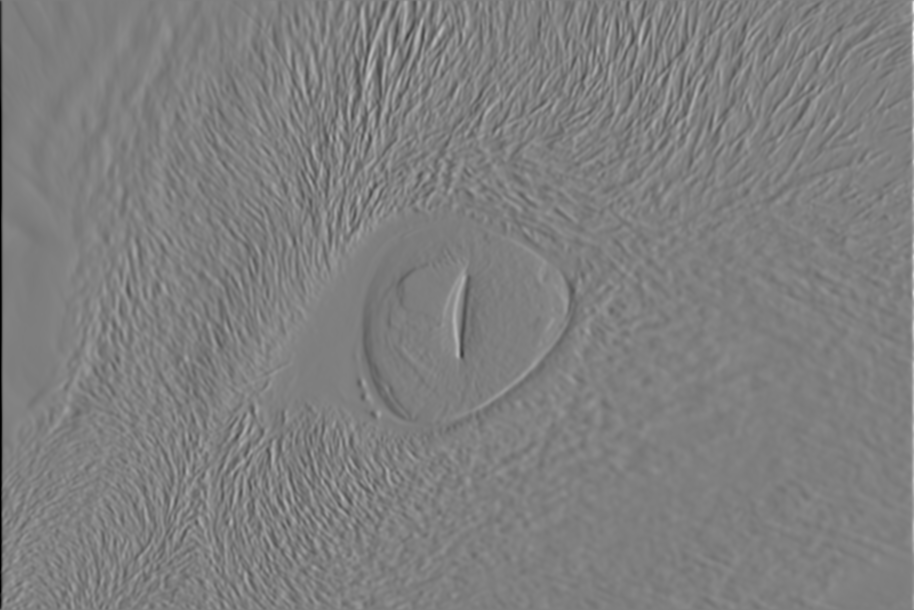

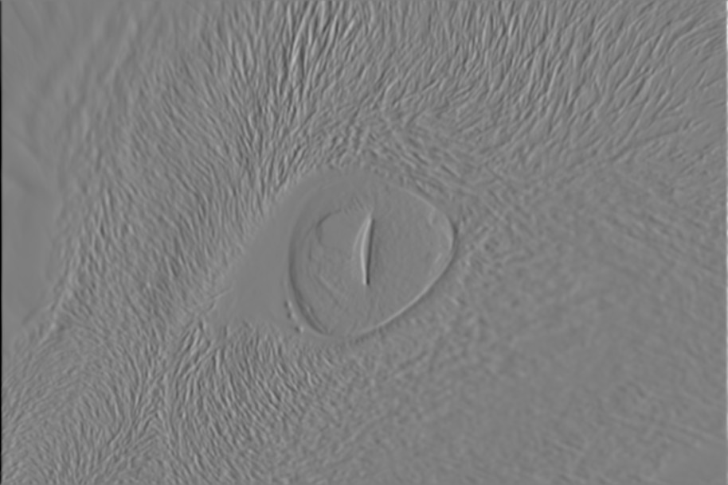

## 5. Gradient magnitude

Recover approximate signed gradients as gx = (horizontal - 127) / 2 and gy = (vertical - 127) / 2, converting to float64 before subtraction. Compute output = clip(4 * (abs(gx) + abs(gy)), 0, 255), then cast to uint8. Prior clipping and quantization make the recovered gradients approximate.


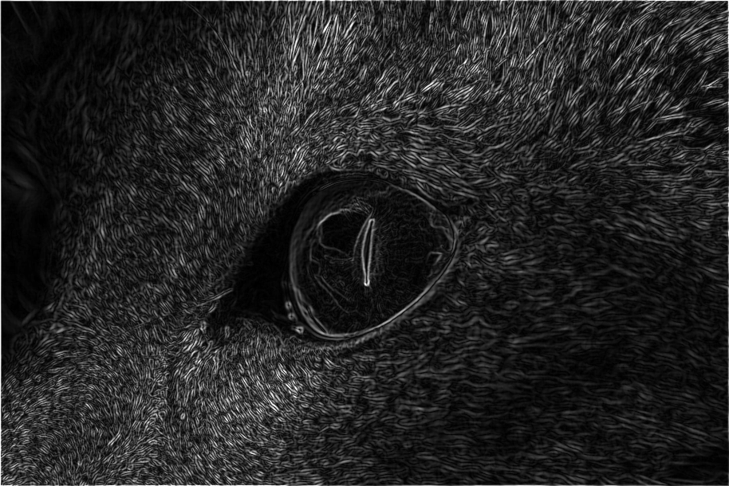

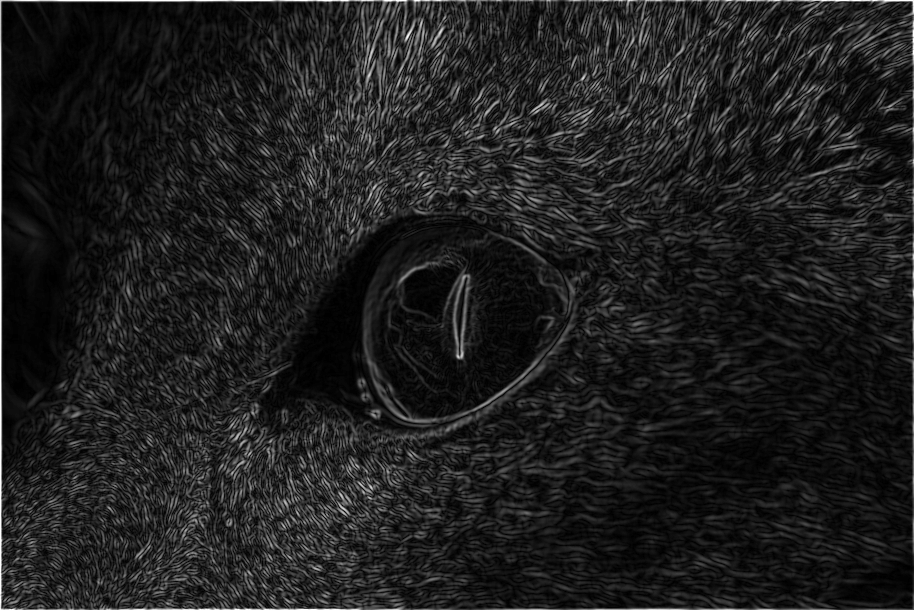

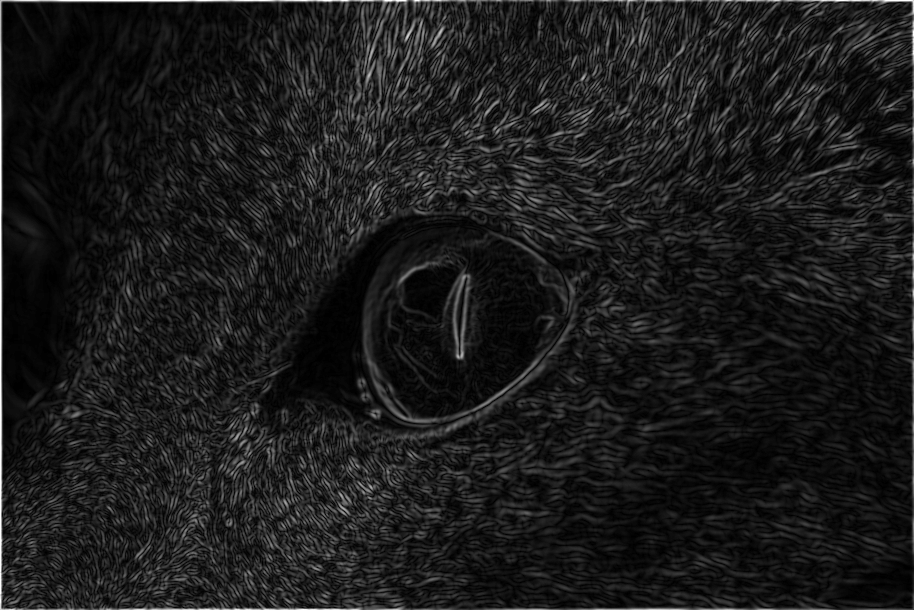

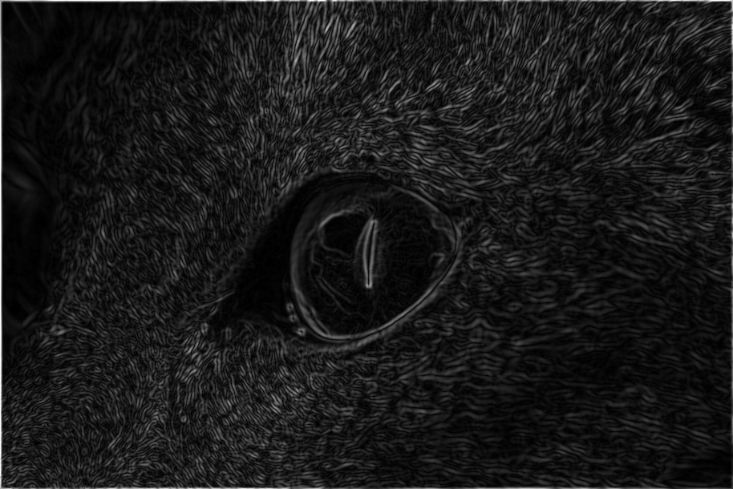

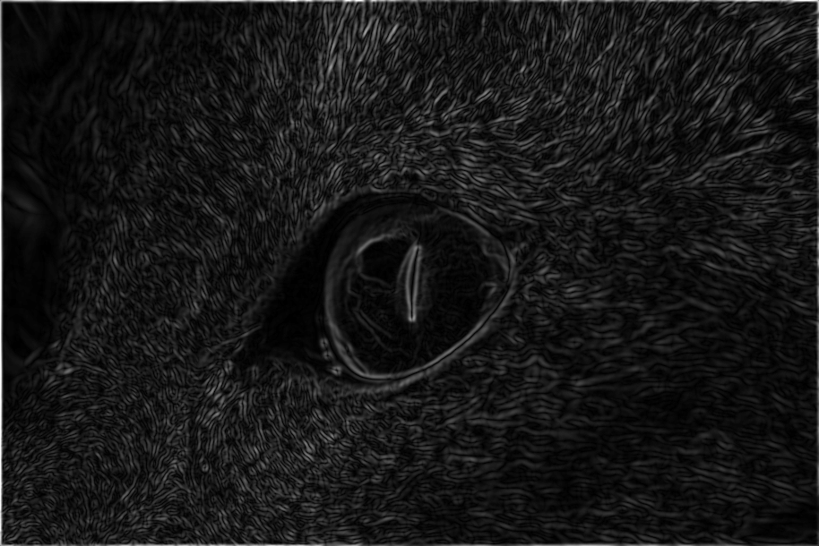

## 6. Built-in convolution

Repeat Task 3 with scipy.signal.convolve2d in two separable passes, mode="same", and zero padding. Pass the derivative kernel unchanged: SciPy flips it internally. Before display mapping, D6 = -D3. Edge positions agree, but bright and dark responses reverse.

Mapping: `clip(2 * derivative + 127, 0, 255).astype(uint8)`. Outputs are single-channel `(610, 914)`; zero padding.

Maximum absolute difference from direct 2D convolution: **0, 0, 0, 0, 0**. Before display mapping, D6 = -D3; Task 6 is not expected to match Task 3.


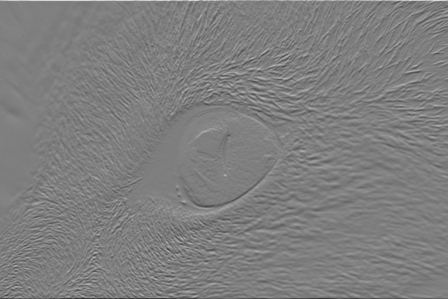


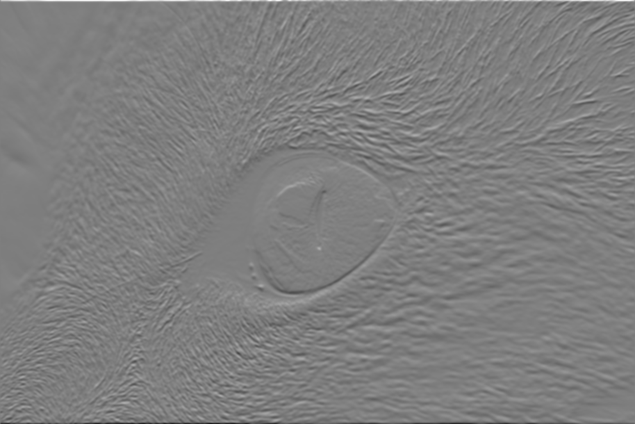

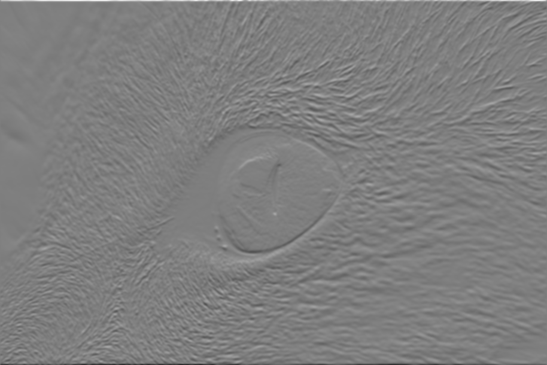

## 7. Repeated box filtering

Start with [1, 1, 1] and convolve the current result with the original filter once per repetition, using np.convolve(..., mode="full"). No normalization is applied. Outputs use int64. After n convolutions the length is 3 + 2n; the coefficient sum is 3 raised to (n + 1).

```text
0 convolutions (length 3): [1, 1, 1]
1 convolutions (length 5): [1, 2, 3, 2, 1]
2 convolutions (length 7): [1, 3, 6, 7, 6, 3, 1]
3 convolutions (length 9): [1, 4, 10, 16, 19, 16, 10, 4, 1]
4 convolutions (length 11): [1, 5, 15, 30, 45, 51, 45, 30, 15, 5, 1]
5 convolutions (length 13): [1, 6, 21, 50, 90, 126, 141, 126, 90, 50, 21, 6, 1]
```

## Output archive

report_outputs contains all 26 result PNGs, two input references, exact returned arrays in output_arrays.npz, box_filter.txt, and validation.json. The original 26 exported PNG/JPEG files are retained in original_exports. JPEG exports may differ from exact arrays because of lossy compression.

The source was not modified. Before code submission, comment active `print` / `cv2.imwrite` calls as required by the handout.
